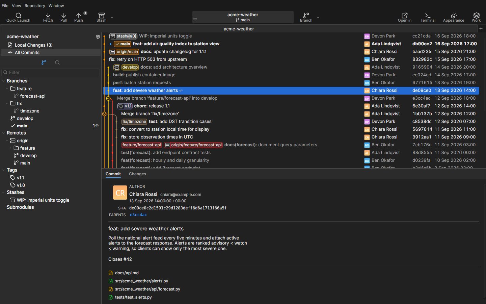
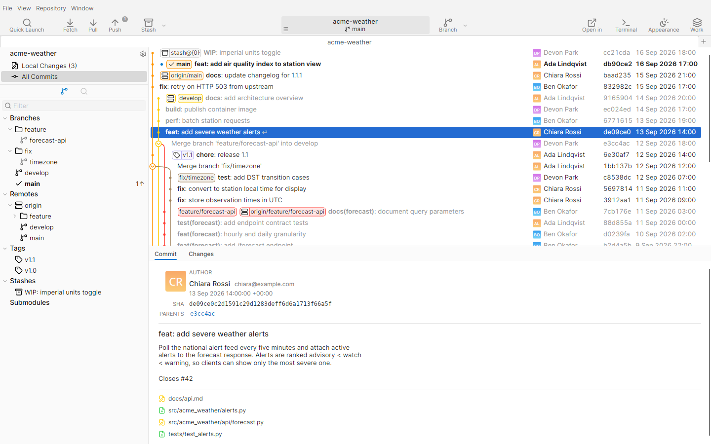
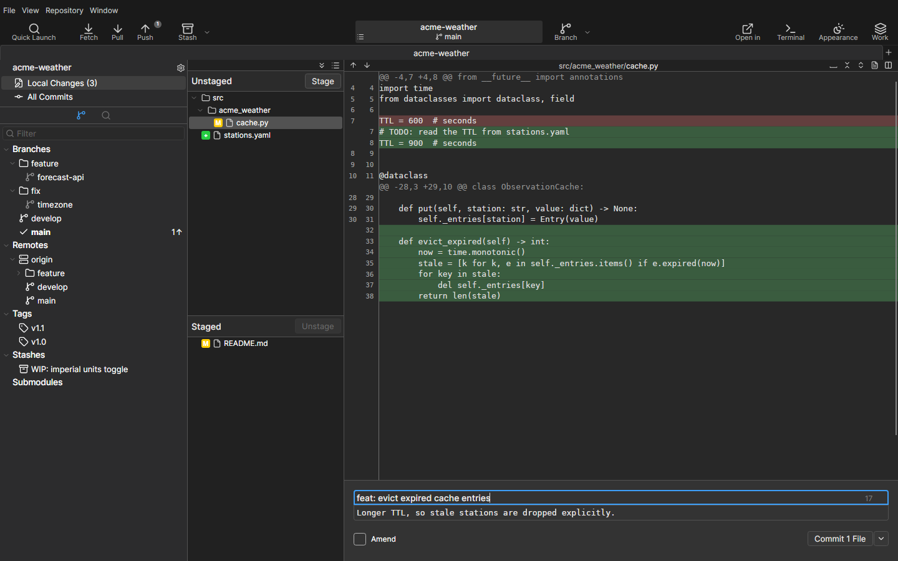

<p align="center"></p>

<h1 align="center">GerGit</h1>

<p align="center">A fast, native Git client for Linux.</p>

<p align="center">
  <a href="https://github.com/IcaruzSoftware/GerGit/releases/latest"></a>
  <a href="LICENSE"></a>
  <a href="https://github.com/IcaruzSoftware/GerGit/actions/workflows/ci.yml"></a>
  <a href="https://launchpad.net/~icaruzsoftware/+archive/ubuntu/gergit"></a>
</p>

Inspired by [Git Fork](https://git-fork.com/). Not affiliated with Git Fork or its developers.



 

GerGit is written in C# on .NET 10 with Avalonia. Every git operation runs the system `git` CLI, so it behaves like the git you already use.

## Features

**History and refs**
- Commit graph with search, branches, remotes, tags, stashes, worktrees and submodules in a sidebar.
- Branch and tag actions, repository tabs, workspaces.

**Local changes**
- Stage and unstage whole files, hunks or single lines; commit and amend.
- Commit and Push in one step.
- Live hook and test progress while committing, merging and pushing.

**Diff and history**
- Inline and side-by-side diff with find, and image diff.
- Blame and file history.
- External diff and merge tools.

**Rebase and conflicts**
- Interactive rebase with drag-and-drop reordering.
- Three-pane conflict resolver.

**Remotes and hosting**
- Fetch, pull and push dialogs, automatic background fetch.
- GitHub and GitLab (including self-hosted) accounts (sign in with a personal access token), clone from a project list, pull and merge requests, notifications.

**Workflow and desktop**
- Quick Launch (Ctrl+P), a working-tree watcher that refreshes on file changes.
- Repository settings window with issue links.
- Light and dark theme that follow the OS, zoom, single instance.

## Install

### Ubuntu (PPA)

Ubuntu 26.04 (amd64):

```bash
sudo add-apt-repository ppa:icaruzsoftware/gergit
sudo apt install gergit
```

### Arch Linux (AUR)

```bash
yay -S gergit-bin
```

Or any other AUR helper.

### Other distributions (tarball)

Any x64 Linux with glibc and git 2.38 or newer: download `gergit-<version>-linux-x64.tar.gz` from the [latest release](https://github.com/IcaruzSoftware/GerGit/releases/latest), then

```bash
tar xf gergit-<version>-linux-x64.tar.gz
./gergit-<version>-linux-x64/GerGit
```

It also needs ICU, OpenSSL, fontconfig and the X11 libraries, which desktop installs normally have. The folder also has the desktop file and icons.

### Build from source

Needs the .NET 10 SDK and git 2.38 or newer.

```bash
dotnet run --project src/GerGit -- /path/to/repo
dotnet test
```

## Requirements

- git 2.38 or newer
- libsecret (and a keyring service such as GNOME Keyring or KWallet) for storing hosting tokens
- Optional: `libnotify-bin` (desktop notifications), `xdg-utils` (opening folders and links), util-linux `setsid` (live hook progress)

## Privacy and network access

- No telemetry.
- GerGit uses the network only for:
  - git operations you start (fetch, pull, push, clone, and "Test Connection" in the Clone dialog), run by your `git`;
  - automatic background fetch, on by default every 10 minutes (Preferences > General > "Fetch remotes automatically"); git also fetches the remotes of checked-out submodules when it needs to (`fetch.recurseSubmodules`);
  - submodule updates after checkout, pull and merge, for submodules you already initialized and checked out (Preferences > General);
  - GitHub and GitLab, when you sign in to an account and for the accounts you added (API, clone, pull and merge requests), and every 15 minutes the notifications of accounts that have notifications turned on;
  - avatars from Gravatar (it receives an MD5 hash of each author's e-mail address), GitHub, your GitLab server, and the avatar addresses (`avatar_url`) in GitHub and GitLab API responses. Only https is used, plain http only for a GitLab server that itself uses http. Turn them off in Preferences > Integration > "Load avatars (Gravatar, GitHub, GitLab)". This one switch covers every avatar download, also the pictures of your accounts and notifications; authors then show their initials.
- Hosting tokens are kept in the system keyring (libsecret).

## Local package build

`packaging/build-deb.sh` builds a `.deb` into `artifacts/` for testing. It needs the .NET 10 SDK and `dpkg-dev`. To install GerGit, use the [PPA](#ubuntu-ppa); releases to the PPA are described in [packaging/PPA.md](packaging/PPA.md), the tarball and AUR package in [packaging/AUR.md](packaging/AUR.md).

## Project

- [Contributing](CONTRIBUTING.md)
- [Security](SECURITY.md)
- [Roadmap](ROADMAP.md)
- [Changelog](CHANGELOG.md)
- [Architecture](docs/architecture.md)
- [Third-party notices](THIRD-PARTY-NOTICES.md)

<a href="https://alternativeto.net/software/gergit/about/?utm_source=badge&amp;utm_medium=referral"></a>

## License

GPL-3.0-or-later. See [LICENSE](LICENSE).
